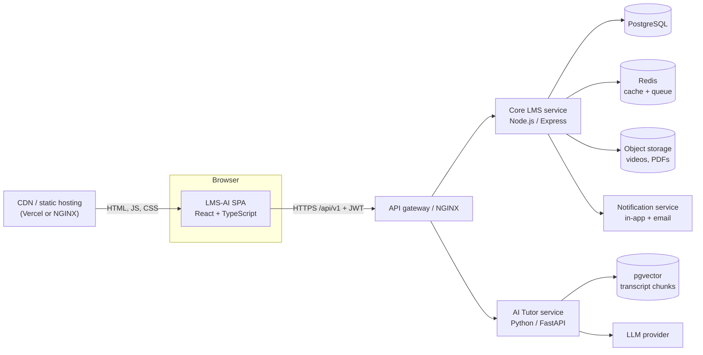
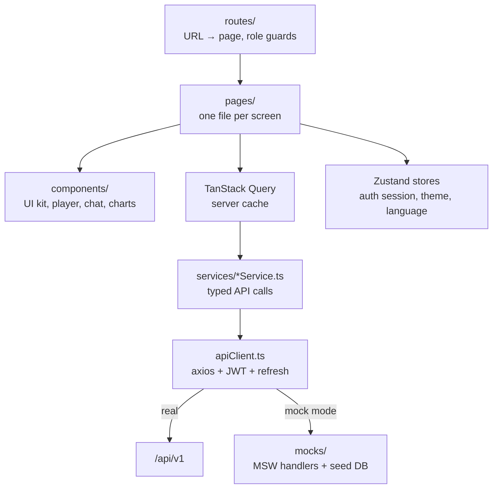
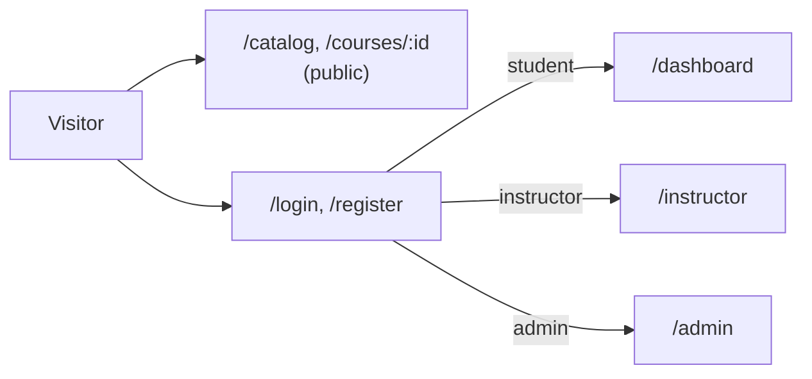
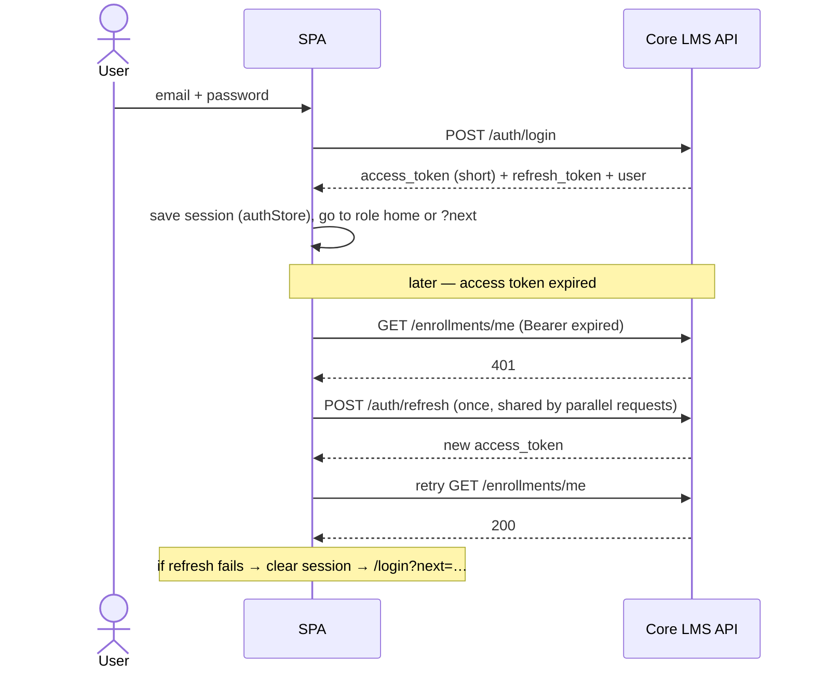
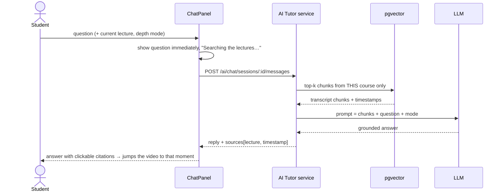
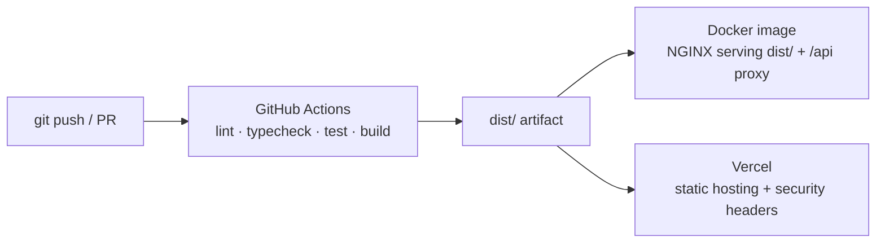

# Frontend architecture

How the LMS-AI web app is put together, and how it fits into the system described in PRD §9. Diagrams are
written in Mermaid, so GitHub renders them directly.

## 1. Where the frontend sits (PRD §9.1)

The frontend is a single-page app (SPA). It never talks to a database or an LLM directly. Every request goes
through the API gateway to the **Core LMS service** (Node.js) or the **AI Tutor service** (Python / FastAPI).

In **mock mode** (`VITE_USE_MOCKS=true`) the browser's Mock Service Worker answers every `/api/v1` call with
the same contract (see [api-contract.md](api-contract.md)), so the whole app runs without a backend.

## 2. Layers inside the app

| Layer | Folder | Rule |
| --- | --- | --- |
| Routing | `src/routes/` | Lazy-loads each page. `ProtectedRoute` checks sign-in and role (PRD §11). |
| Pages | `src/pages/` | Compose components; fetch with `useQuery`, change data with `useMutation`. |
| Components | `src/components/` | Reusable UI. No direct API calls. |
| Services | `src/services/` | The **only** place that knows URLs. One file per PRD §8 domain. |
| API client | `src/services/apiClient.ts` | Adds `Authorization`, refreshes expired tokens once, normalises the §8.8 error envelope. |
| State | `src/store/` | Zustand: `authStore` (user + tokens), `uiStore` (theme, language). Everything from the server lives in the Query cache, not in stores. |
| Mock backend | `src/mocks/` | MSW handlers, seeded data and a small lexical "RAG" engine. Dev/demo only. |

## 3. Roles, routes and guards (PRD §11)

| Area | Routes | Who |
| --- | --- | --- |
| Public | `/catalog`, `/courses/:id`, `/login`, `/register` | everyone (`/login` and `/register` redirect signed-in users home) |
| Learning | `/dashboard`, `/my-learning`, `/learn/:courseId/:lectureId`, `/quizzes`, `/assignments`, `/tutor`, `/study-plan`, `/achievements`, `/certificates` | student |
| Community | `/courses/:id/forum`, `/courses/:id/forum/:threadId`, `/settings` | any signed-in user (server checks enrolment) |
| Teaching | `/instructor/*` (courses, grading, quizzes, analytics, announcements) | instructor, admin |
| Platform | `/admin/*` (overview, users & roles, approvals, moderation, audit log) | admin |

- `/` sends signed-in users to their role's home and visitors to the catalog.
- A signed-out visitor who opens a protected page goes to `/login?next=<page>` and returns there after signing in.
  `next` only accepts in-app paths (`utils/safeUrl.ts`).
- The wrong role sees a 403 page; the sidebar only shows links for the user's roles.
- Registration always creates a **student**; an admin grants instructor/admin roles (FR-AD4).

## 4. Sign-in and token refresh (PRD §8.1, §6)

## 5. Asking the AI tutor (PRD §9.2)

- Answers come only from the course's own material (FR-A2). With no match the tutor says so and lists the
  course's topics instead of guessing.
- Depth: Beginner / Intermediate / Advanced (FR-A6). A student's first chat in a course starts at a depth based on
  their topic mastery (FR-A8).
- "New chat" starts a fresh conversation; old chats stay in the list and can be deleted (ChatGPT-style).

## 6. Data and caching

| Data | Where it lives | Why |
| --- | --- | --- |
| Courses, enrolments, quizzes, chats, notifications… | TanStack Query cache, keyed by `qk.*` in `queryClient.ts` | One source of truth; mutations invalidate the right keys so every page updates. |
| Signed-in user + tokens | `authStore` (persisted) | Survives reloads; cleared on sign-out. |
| Theme, language | `uiStore` (persisted) | User preference. |
| Playback speed, generated study plan | `localStorage`, keyed per user | Small conveniences; study plans are per user so shared computers stay private. |
| Notifications, role changes | polled (`refetchInterval`) | New notifications and admin role changes appear without a reload. |

## 7. Cross-cutting features

- **Theming:** design tokens as CSS variables in `styles/index.css`; light, dark and "system".
- **Languages:** i18next scaffolding — English, தமிழ், සිංහල, हिन्दी for navigation and common actions (PRD §3).
- **Accessibility:** WCAG 2.1 AA checked with axe on every page and dialog (0 violations); skip link, focus rings,
  focus-trapped dialogs, chart ⇄ table toggle, keyboard-friendly video controls.
- **Security:** see the Security section of the root [README](../README.md#security-prd-day-27-review).
- **Errors:** every list has loading, empty and error states; failed actions show a toast with the server message.

## 8. Build, test and deploy (PRD §14)

| Command | What it does |
| --- | --- |
| `npm run dev` | Vite dev server on `http://localhost:5173` (mock mode by default) |
| `npm run lint` / `npm run typecheck` | ESLint 9 / `tsc --noEmit` |
| `npm test` | Vitest unit + component tests |
| `npm run build` | Production build into `dist/` |
| `docker build -t lms-ai-frontend frontend` | NGINX image (`VITE_USE_MOCKS=false` by default) |
